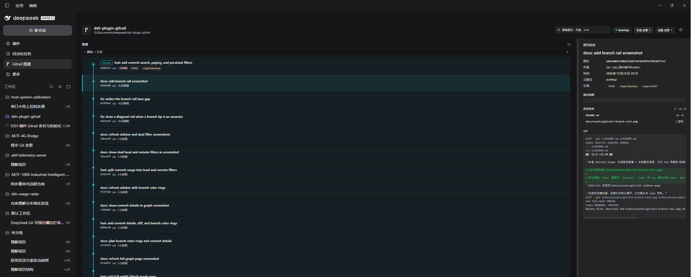
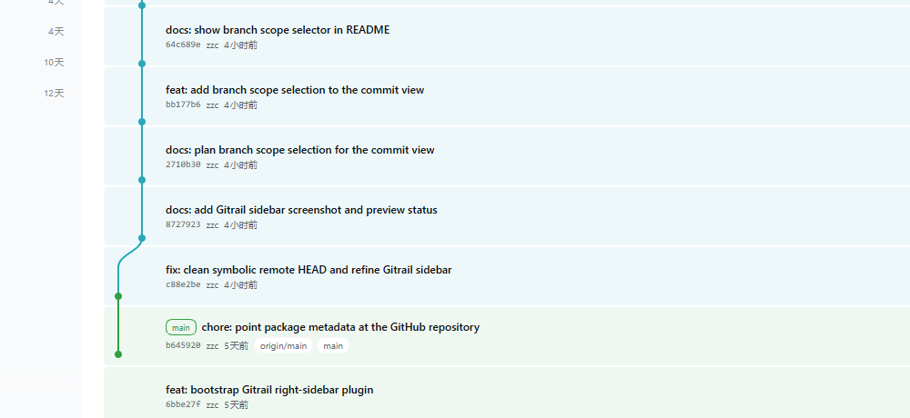
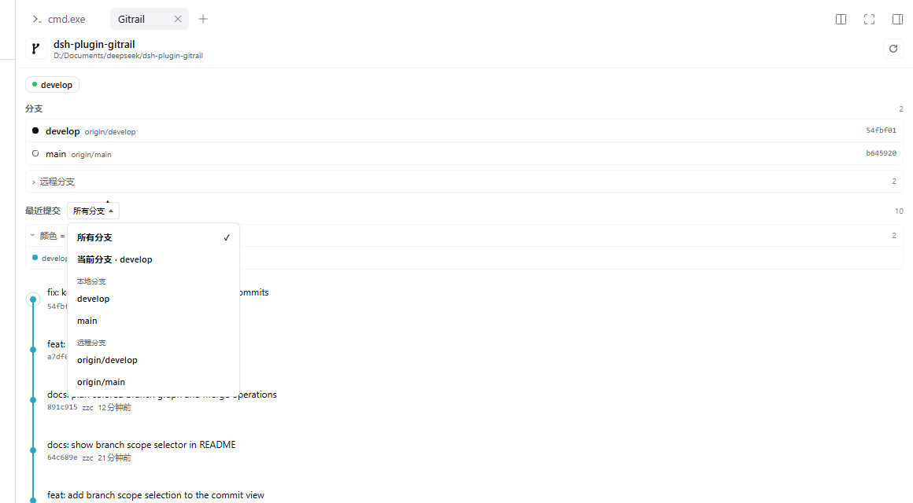

# Gitrail

> **Rail for your repo** — 把仓库的分支与提交放进 DeepSeek Harness 的右侧栏。

`dsh-plugin-gitrail` 是一个 DSH Web 插件：在右侧栏新增一个 **Gitrail** 页面，读取当前会话工作区的 git 仓库，展示当前分支、本地/远程分支和最近提交。

- **只读**：不 checkout、不 fetch、不写配置，也不碰凭据。
- **不联网**：所有数据来自本机 `git`，浏览器只访问回环地址上的宿主路由。
- **单包、无构建**：宿主编排在 `index.js` / `lib/git.js`，浏览器半边是纯 JS 的 `client.js`，没有 JSX、打包器或运行时依赖。
- **贴着宿主长**：右侧栏 tab type + guide entry，使用 `--dsw-alias-*` 主题令牌，亮/暗主题一致。



*全宽 Gitrail Graph：左侧彩色图谱 + 右侧提交信息；分支 tip 用颜色/标签标注。*



*本仓库的 `main` 落后于 `develop`：`main` 的 tip 留在左侧 lane，`develop` 单独占右侧 lane，斜线在 `main` 处向上接入，而不是一条直线。*


*右侧栏快捷视图：远程分支默认展开，分支圆点与 lane 同色。*



*「最近提交」旁的两个多选下拉：本地、远程各自勾选，组合后一起展示。*

> 状态：**v0.9.0 / early**。已通过 `npm run check` 和 49 项 `npm test`，并在 desktop profile 验证按文件 diff、复制 SHA、搜索、分页、双下拉持久化与分支 rail（暗色主题）；亮色主题与窄栏表现仍待检查。

---

## 为什么叫 Gitrail

| 项 | 值 |
|---|---|
| 包名 | `dsh-plugin-gitrail`（npm 上尚未占用） |
| 仓库名 | `gitrail` |
| 中文名 | Gitrail 侧栏 / 「轨」 |
| 一句话 | Rail for your repo — git 分支与提交的侧栏视图 |

`rail` 同时指**铁轨**（分支轨道、提交图的视觉隐喻）和 **rail / sidebar**（侧边栏）；短、好念、logo 也好做——一条分叉的轨道。

命名上的取舍记录在 [docs/naming.md](docs/naming.md)：避开 `dsh-plugin-git`（npm 上已有同名包，功能相邻）、`gitlens`（与 VS Code 插件商标冲突）和只强调侧栏的 `sidegit`。

---

## 现在能做什么（v0.9）

左侧栏的 **Gitrail 图谱** 打开全宽页面：左侧彩色图谱 + 右侧提交信息；右侧栏的「仓库」保留为快捷视图。

- **按文件看 diff**：点击「改动文件」里的任意一行，diff 只显示该文件；再点一次或「全部文件」恢复。文件行有选中态，二进制/仅模式变更会给出说明。
- **复制 SHA**：提交信息里的 SHA 旁有「复制」按钮，复制成功短暂显示「已复制」。
- **文件外部打开**：文件行末尾的 `↗` 在宿主资源打开器可用时打开 `dsh-resource://file/...`，和行内 diff 选择互不干扰。
- **提交搜索**：按提交说明、作者、邮箱、SHA 或 refs 搜索；搜索时自动把窗口扩到最近 500 条，结果以无图谱的平铺列表显示。
- **加载更多**：默认 80 条，底部「加载更多」每次增加 100 条，最多 500 条；固定 64px 行高 + `content-visibility` 做轻量虚拟化。
- **筛选同步与记忆**：本地/远程筛选在右侧栏和全宽页之间共享，并按 session 存在 `localStorage`；重新打开不需要再选一次。
- **分支下拉搜索**：本地/远程菜单里可直接输入过滤，支持方向键、Enter、Escape。
- **自动刷新**：窗口重新聚焦或 tab 重新可见时，800ms 防抖后静默刷新；手动刷新保留。
- **分支斜向汇入**：当一个选中分支的 tip 是另一个选中分支的祖先（本仓库 `main` 落后于 `develop`）时，新分支单独占一条 lane，并用斜线从旧 tip 向上接到新分支；不再画成一条直线。
- **本地 / 远程两个多选下拉**：`最近提交` 旁分别选择本地分支和远程分支；两边都勾选时合并展示，任一边都可以全选、部分选择或清空。空选择显示「未选择任何分支」。
- **分支列表点选**：远程分支默认展开；点击分支行会切换它在本组筛选里的选中状态，与两个下拉同步。
- **分支色圈**：右侧栏「分支」列表的圆点与图谱 lane 同色；当前分支实心、普通分支空心、远程分支虚线环。
- **提交标题加粗**：subject 600 字重，两行截断；SHA / 作者 / 时间仍为次要字重。
- **全宽图谱页**：分支 tip 在页面顶部用 pill 标注；共享历史到达另一个分支 tip 时，lane 会交接给该分支的颜色（例如 `develop` 在 `main` 的 tip 处变成 `main` 色），因此所有分支不再只有一种颜色。
- **点提交看详情**：右侧栏点提交 → 打开全宽页并选中；全宽页点行 → 右侧「提交信息」显示完整 message、作者/提交者、时间、父提交、引用、改动文件（`+/-`、binary、rename）和按行着色的 diff。文件行在可用时打开现有 `dsh-resource://file/...` 预览。
- 提交行按 lane 色淡染；merge/fork 行显示操作徽标与方向。
- **彩色提交图**：每条分支一条 lane 和稳定颜色；分叉点、合并节点、HEAD 光晕、远程分支虚线都能直接看出。
- **合并方向**：第一 parent 是迁入目标（实线），第二及以后 parent 是迁出源（虚线 + 来源色）；tooltip 在能推断时显示 `合并: main ← feature`。
- 合并行和分叉行在 meta 里有「合并」/「分叉点」徽标，边框取 lane 颜色；不只靠图形形状区分。
- 显示仓库名、绝对路径、当前分支（含 detached HEAD / 空仓库状态）。
- 显示工作区改动数、相对上游的 ahead / behind。
- 列出最近 80 条提交：短 SHA、作者、相对时间、refs（分支 / tag）、最多两行标题；完整标题在 tooltip。
- 可折叠的「颜色 = 分支」图例；固定 64px 行高保证 SVG 轨道与提交行对齐。
- 手动刷新；读取中保留旧数据，不闪空屏。
- 错误按原因给出可操作的文案：会话不存在、没有工作目录、不是 git 仓库、找不到 git、超时、分支已删除、提交不存在。

**还没有**：任何写操作、真实的 reflog 操作时间线。见 [docs/roadmap.md](docs/roadmap.md)。

---

## 安装

前置条件：DSH Web（`desktop` profile 或等价组合）、右侧栏（`@deepseek-ai/dsh-client-ui-sidebar-right`）已启用、`git` 在 `PATH` 中、Node.js ≥ 22。

### 用 `plugin_manager` 安装（推荐）

在任意 DSH 会话里，把本目录作为本地 bundle 安装：

```text
plugin_manager  action: install_bundle
target: D:\Documents\deepseek\dsh-plugin-gitrail
```

安装会写入当前 profile 的 bundle 选择与依赖，不需要手动改 `package.json` 或 `cordis.patch.yml`。若页面没有立刻出现「仓库」入口，重启 DSH 后刷新页面；替换已安装包时，新的浏览器模块需要重启才能生效。

### 安装后验证

1. 打开一个位于 git 仓库中的会话。
2. 左侧栏的全局面板列表应出现「Gitrail 图谱」；打开后是左侧彩色图谱 + 右侧提交信息。
3. 右侧栏顶部的 `+` / guide 中应出现「仓库」卡片；它的标题栏有「全宽打开图谱」按钮。
4. 两个视图都应显示所有分支的提交；用「本地」「远程」两个多选下拉组合范围，点分支行也可以切换。
5. 远程分支列表默认展开；分支圆点颜色应与图谱 lane 一致。
6. 点任意提交：右侧栏会打开全宽页并选中；右侧显示 message、文件 `+/-` 与 diff。
7. 若面板报错，先看错误码：`git/not-a-repo`、`git/unavailable`、`session/no-cwd`、`git/commit-not-found` 分别对应不同的环境问题。

> 本仓库只提供 bundle，不自动修改 profile。不要手工复制到 `$DSH_HOME` 或编辑 profile 的 `cordis.patch.yml`，除非你明确知道自己在做什么。

---

## 开发

没有构建步骤。改完 `client.js` 就是改完浏览器产物；样式使用宿主主题令牌，不引入 CSS 框架。

```powershell
npm run check   # node --check + 清单/本地化/图标一致性
npm test        # 49 项测试：解析器、路由、limit、搜索、patch、双组范围、rail、图形与提交详情
```

| 路径 | 职责 |
|---|---|
| `index.js` | Host 半边：注册 `/dsh-plugin-gitrail/repo`，把 Session 解析为工作区目录，返回 JSON |
| `lib/git.js` | 只读 git 适配器：参数数组、超时、输出上限、稳定的 `GitError` 错误码 |
| `client.js` | 浏览器半边：注册 `gitrail` tab type、guide entry 和 `sidebar.right.pane.tab` 内容 |
| `cordis.patch.yml` | bundle 的插入行（id 与包名一致） |
| `locale/en.json`、`locale/zh.json` | Plugin Manager 读取的 `meta.title` / `meta.description` |
| `icon.svg` | 导出的插件图标（分叉轨道） |
| `test/git.test.mjs` | 解析器 + 真实临时仓库的集成测试 |
| `test/host.test.mjs` | 路由、loopback、Session 解析与错误码测试 |
| `test-support/git.mjs` | 测试用临时仓库工具 |
| `docs/` | 架构、路线图、命名决策 |

### 客户端模块约定

- `window.__ModuleLoader__.load({ id, factory })`，`id` 必须等于包名 `dsh-plugin-gitrail`。
- 只 `require('react')`；不 `require` 任何 `@deepseek-ai/dsh-client-*` 包。
- 通过 `ctx.sidebarRightTabs.register()` 注册页面类型，通过 `ctx.slots.register()` 注册该类型的 body。
- 所有可见文案走 `ctx.locale`；颜色只用 `--dsw-alias-*` 令牌。
- 不向 `document.body` 追加节点，不读取其他插件的 DOM。

### 宿主模块约定

- `export const name` / `export const inject = ['webServer']` / `export function apply(ctx)`。
- 注册资源一律包在 `ctx.effect()` 里，返回 disposer。
- 只接受 `session` id，**绝不接受浏览器传来的文件系统路径**；工作区路径由宿主从 Session 解析。
- git 只用参数数组调用，禁用交互提示与 optional locks，设置超时与输出上限。

---

## 数据与安全边界

| 边界 | 做法 |
|---|---|
| 读取范围 | 只读当前 Session 的工作区仓库；`git rev-parse --show-toplevel` 决定根 |
| 网络 | Host 只注册本机回环路由；Handler 拒绝非 loopback 的 `Host` |
| 客户端权限 | 浏览器不能指定路径、不能执行 git、不能读文件 |
| 命令注入 | `execFile('git', ['-C', cwd, ...args])`，不经过 shell；所有参数在代码里固定 |
| 写操作 | 无。没有 checkout / fetch / pull / commit / config 写入口 |
| 凭据 | 不读取、不传递、不记录 |
| 资源上限 | 10s 超时、4 MiB stdout、80 条提交、每类 200 个分支 |
| 错误信息 | 稳定错误码 + 简短原因；不返回仓库内容或完整 stderr |

HTTP 契约与错误码见 [docs/architecture.md](docs/architecture.md)。

---

## 已知限制

- **没有提交图 lane**：当前按 `HEAD` 的线性历史渲染一条轨道，父提交已随数据返回，lane 布局是下一步。
- **没有 diff**：提交行只展示摘要，点开文件 / 看 patch 尚未实现。
- **没有自动刷新**：需要点刷新按钮；不会轮询。
- **单仓库**：一个 Session 的工作区对应一个仓库；多仓库 / 子模块视图未设计。
- **视觉未验证**：本机尚未安装到运行中的 DSH，亮/暗主题与窄栏表现仍待真机检查。
- **未发布 npm**：`package.json` 仍是 `private: true`，发布前需移除并核对 `files`。

---

## 路线图

| 里程碑 | 内容 |
|---|---|
| **M0（已完成）** | 仓库骨架、右侧栏 tab type、Host 只读 git 读取、分支/提交列表、测试 |
| **M1** | 提交图 lane、分支聚焦、窗口重新聚焦时刷新、空态与长列表打磨 |
| **M2** | 提交详情与 diff / stat 预览（新的 tab 或资源类型，不劫持文件预览） |
| **M3** | 显式用户操作：checkout / fetch（确认 + 失败回显；默认不暴露给 agent） |
| **M4** | npm 发布、英文 README、CI、安装文档截图 |

细节与开放问题见 [docs/roadmap.md](docs/roadmap.md)。

---

## License

[MIT](LICENSE) © 2026 Gitrail contributors
